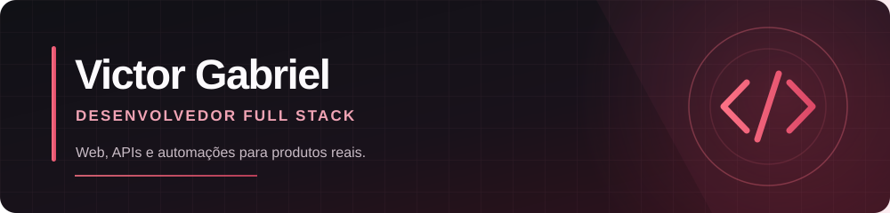

 

**Python · React · TypeScript · Node.js · PostgreSQL**

Construo aplicações web, APIs e automações com foco em organização, integração e uso real.

[**Projetos**](#projeto-em-destaque) &nbsp;·&nbsp; [**Atividade**](#atividade-no-github) &nbsp;·&nbsp; [**LinkedIn**](https://www.linkedin.com/in/victor-gabriel-38b101354/) &nbsp;·&nbsp; [**E-mail**](mailto:victorrochapires48@gmail.com)

---

## Sobre mim

Sou desenvolvedor **Full Stack** e trabalho principalmente com **Python, React e PostgreSQL**. Comecei a estudar programação aos 16 anos e, desde então, venho aprofundando meus conhecimentos em aplicações web, comunicação entre sistemas, APIs e bancos de dados.

Gosto de compreender o problema antes de escrever o código, estruturar soluções que possam evoluir e cuidar da experiência de quem vai utilizá-las.

Tenho interesse em oportunidades de desenvolvimento **Full Stack, backend e web**, inclusive em formato remoto.

## Tecnologias e ferramentas

| Área | Tecnologias |
| :-- | :-- |
| **Backend e automação** | Python, Node.js, APIs REST |
| **Frontend** | React, Vite, TypeScript, JavaScript |
| **Banco de dados** | PostgreSQL |
| **Integrações** | Discord API, OAuth2 |
| **Fluxo de desenvolvimento** | Git, GitHub |

## Projeto em destaque

### Isekai Bot

**Automação para comunidades Discord com gerenciamento pelo navegador.**

O Isekai Bot integra um bot em Python, uma API e um painel web para administrar e configurar funcionalidades em diferentes servidores do Discord.

O projeto envolve:

- **Bot em Python:** comandos, eventos e automações no Discord.
- **API e integração:** comunicação entre as configurações do painel, o bot e o banco de dados.
- **Dashboard em React:** interface de gerenciamento por servidor.
- **PostgreSQL:** persistência das configurações e dos dados necessários.
- **OAuth2 do Discord:** autenticação para acesso ao painel.

É um projeto em evolução, no qual trabalho com arquitetura, permissões, consistência de dados e experiência do usuário.

**Stack:** `Python` · `React` · `Vite` · `PostgreSQL` · `Discord OAuth2`

[**Conhecer o Isekai Bot**](https://isekaiblox.com.br/) &nbsp;·&nbsp; [**Comunidade no Discord**](https://discord.gg/SdkU86bQwq)

> O código principal está em um repositório privado.

## Atividade no GitHub

<picture>
  <source media="(prefers-color-scheme: dark)" srcset="./assets/stats/overview.dark.svg" />
  
</picture>

 

<picture>
  <source media="(prefers-color-scheme: dark)" srcset="./assets/stats/contributions.dark.svg" />
  
</picture>

 

<picture>
  <source media="(prefers-color-scheme: dark)" srcset="./assets/stats/momentum.dark.svg" />
  
</picture>

 

<picture>
  <source media="(prefers-color-scheme: dark)" srcset="./assets/stats/languages.dark.svg" />
  
</picture>

Os gráficos são gerados por **GitHub Actions** e armazenados neste repositório, sem depender de servidores públicos de estatísticas. A atualização está **agendada a cada seis horas** e também pode ser iniciada manualmente em [**Actions → Atualizar estatísticas do perfil**](https://github.com/vgpgod/vgpgod/actions/workflows/profile-metrics.yml).

*Os dados seguem a visibilidade e as permissões do GitHub. O trabalho em repositórios privados pode não aparecer nas métricas públicas.*

## Contato

Para conversar sobre projetos, desenvolvimento ou oportunidades profissionais:

**[E-mail](mailto:victorrochapires48@gmail.com)** &nbsp;·&nbsp; **[LinkedIn](https://www.linkedin.com/in/victor-gabriel-38b101354/)** &nbsp;·&nbsp; **[GitHub](https://github.com/vgpgod)**

---

Desenvolvimento com foco em soluções claras, funcionais e sustentáveis.

