 

**Python · React · TypeScript · Node.js · PostgreSQL**

Desenvolvimento web, APIs e automações — da ideia à aplicação funcionando.

[**Projetos**](#projeto-em-destaque) &nbsp;·&nbsp; [**Tecnologias**](#tecnologias-e-ferramentas) &nbsp;·&nbsp; [**Atividade**](#atividade-no-github) &nbsp;·&nbsp; [**Contato**](#contato)

---

## Sobre mim

Sou **Victor Gabriel**, desenvolvedor Full Stack com foco em criar produtos digitais que sejam fáceis de usar e bem estruturados por dentro.

Comecei a estudar programação aos 16 anos. O que mais me interessa nessa área é conectar as diferentes partes de uma aplicação: a interface que as pessoas utilizam, a API que processa as operações e o banco de dados que mantém tudo consistente.

Atualmente, trabalho principalmente com **Python, React, TypeScript e PostgreSQL**. Gosto de desenvolver projetos próprios, resolver problemas reais e melhorar continuamente a organização, a segurança e a experiência dos sistemas que construo.

Também tenho interesse em oportunidades de desenvolvimento **Full Stack, backend e aplicações web**, inclusive remotas.

## Tecnologias e ferramentas

### Backend e automação

  
  

### Interfaces e frontend

  
  
  
  

### Banco de dados e integrações

  
  

### Versionamento

  
  

## Projeto em destaque

### Isekai Bot

**Um bot para Discord conectado a uma plataforma de gerenciamento web.**

O **Isekai Bot** é um projeto próprio voltado à administração de comunidades. A ideia é reunir ferramentas importantes para o dia a dia de um servidor em uma experiência mais organizada, combinando os recursos do bot com um painel acessível pelo navegador.

O desenvolvimento envolve três partes que precisam conversar entre si:

- **Bot e automações:** comandos e recursos de moderação, organização e gerenciamento de comunidades Discord.
- **Painel web:** interface em React para visualizar e configurar funcionalidades de cada servidor.
- **Backend e dados:** API em Python, PostgreSQL e autenticação com Discord OAuth2, conectando as ações do painel ao funcionamento do bot.

Entre os recursos trabalhados no projeto estão sistemas de **tickets, VIP, moderação, registros, XP e rankings**. Além das funcionalidades, o foco é manter a experiência clara e cuidar de integrações, permissões e consistência das informações.

**Tecnologias:** `Python` · `React` · `Vite` · `PostgreSQL` · `Discord OAuth2`

> Projeto em evolução. O repositório principal é privado.

## Atividade no GitHub

<picture>
  <source media="(prefers-color-scheme: dark)" srcset="./assets/stats/overview.dark.svg" />
  
</picture>

 

<picture>
  <source media="(prefers-color-scheme: dark)" srcset="./assets/stats/contributions.dark.svg" />
  
</picture>

 

<picture>
  <source media="(prefers-color-scheme: dark)" srcset="./assets/stats/momentum.dark.svg" />
  
</picture>

 

<picture>
  <source media="(prefers-color-scheme: dark)" srcset="./assets/stats/languages.dark.svg" />
  
</picture>

## Contato

Estou aberto a conversar sobre projetos, colaboração e oportunidades de desenvolvimento. Você pode entrar em contato por e-mail ou LinkedIn, ou me encontrar no Discord.

**Meu usuário no Discord:** `@goddevs` · [Servidor do Isekai Bot](https://discord.gg/SdkU86bQwq)

---

Desenvolvimento com atenção à experiência, à arquitetura e aos detalhes.

